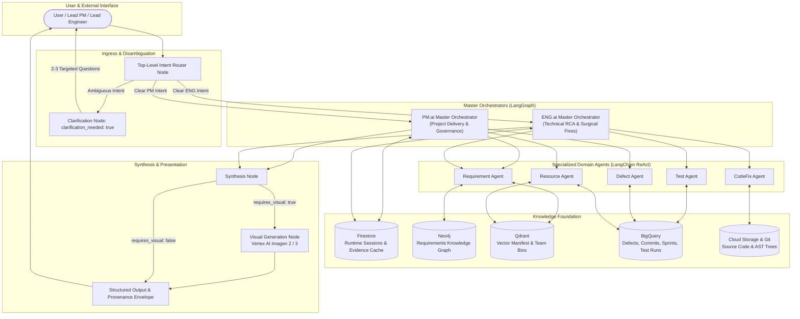
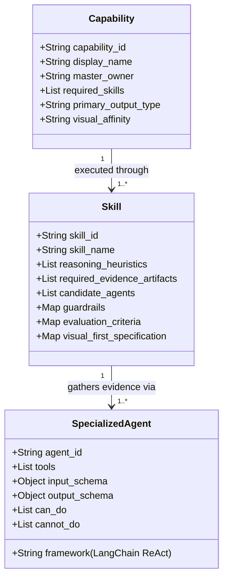
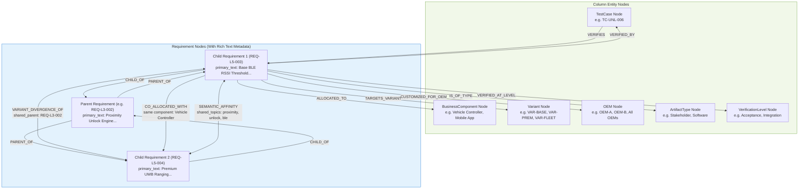
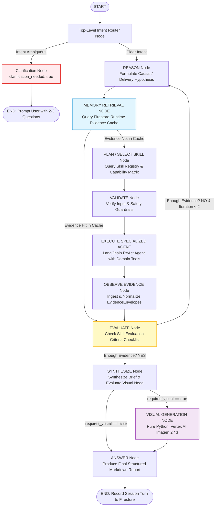

# AXIOM: Google Cloud Multi-Agent Intelligence System
### Architecture Specification & Operational Blueprint

> **Mission**: Detect. Decide. Deliver.  
> **Target Cloud**: Google Cloud Platform (Cloud Run, Vertex AI Gemini, BigQuery, Firestore, Cloud Storage, Secret Manager)  
> **Knowledge Foundation**: Neo4j (Requirements KG), Qdrant (Manifest & Team Embeddings), Firestore (Runtime Memory)

---

## 1. Executive Architecture Summary

**AXIOM** is an evidence-driven, cognitive multi-agent intelligence system designed for safety-critical and high-velocity engineering programs. Unlike rigid, procedural Python automation scripts, AXIOM implements an autonomous **Cognitive Architecture** (inspired by Jev and Laya cognitive agent paradigms):
- **PM.ai Master**: Governs project delivery, milestone commitments, defect triage, sprint replanning, and resource capacity.
- **ENG.ai Master**: Governs deep technical investigations, 8D problem solving, AST inspection, deterministic root-cause discovery, surgical patch proposals, and test coverage expansion.
- **Specialized LangChain ReAct Agents**: Act as domain-bounded sensors and investigation tools to gather verifiable **EvidenceEnvelopes**.
- **Knowledge Foundation**: Combines **Neo4j** (Requirements Knowledge Graph), **Qdrant** (Vector Search for manifest & team bios), **Firestore** (Session turns, user preferences, runtime evidence caching), and **BigQuery** (Structured project facts).



---

## 2. Capabilities vs. Skills vs. Specialized Agents

A core tenet of AXIOM is the strict separation between what a system offers (**Capabilities**), how it reasons (**Skills**), and where it gathers evidence (**Agents**).



### The Three Distinct Layers:

1. **Capabilities (`registries/capability_matrix.json`)**:
   - What the Master offers to human stakeholders (e.g., `sprint_replanning`, `defect_triage`, `root_cause_analysis`, `eight_d_analysis`).
   - Capabilities represent end-to-end deliverables, defined in Master system prompts alongside explicit Do's, Don'ts, and Safety boundaries.

2. **Skills (`skills/*.json` & `registries/skill_registry.json`)**:
   - The cognitive competencies, analytical rules, reasoning heuristics, and evidence checklists the Master uses to execute capabilities.
   - Examples: `velocity_analysis_skill`, `defect_correlation_skill`, `root_cause_discovery_skill`, `test_coverage_analysis_skill`.
   - Each skill specifies the required EvidenceEnvelopes, input guardrails, pass criteria for the "Enough evidence?" evaluation node, and visual generation prompts.

3. **Specialized Agents (`agent_cards/*.json` & `agents/*.py`)**:
   - Bounded LangChain ReAct agents equipped with domain tools.
   - Masters delegate to these agents to interact directly with databases (Neo4j, Qdrant, BigQuery, Cloud Storage) and return structured **EvidenceEnvelopes**.
   - Specialized Agents do **not** take executive decisions; they discover and verify facts.

---

## 3. Data-Driven Knowledge Graph Architecture (Neo4j AuraDB)

The AXIOM Requirements Knowledge Graph is **100% data-driven**, constructed directly from `data/requirements_master_v5.csv` and `data/test_cases_master_v5.csv`:
- **Columns become Entity Nodes**: `BusinessComponent`, `Variant`, `OEM`, `ArtifactType`, `VerificationLevel`, and `TestCase`.
- **Rows become `Requirement` Nodes**: Storing rich text metadata including `primary_text`, `verification_criteria`, `variant_implementation_notes`, `status`, and `level`.
- **Direct Relationships**: Represent structural hierarchy and architectural allocations.
- **Semantic Relationships**: Dynamically computed from data patterns (variant divergence across siblings, component co-allocation, and topical keyword affinity).



### Knowledge Graph Metrics (Generated from CSV):
- **Total Nodes**: 179
  - 74 Requirements (with rich text metadata: `primary_text`, `verification_criteria`, `variant_implementation_notes`)
  - 5 Business Components (`System`, `Mobile App`, `Cloud Key Service`, `Security Module`, `Vehicle Controller`)
  - 4 Variants (`VAR-BASE`, `VAR-PREM`, `VAR-FLEET`, `VAR-GLOB`)
  - 6 OEMs (`All OEMs`, `OEM-A`, `OEM-B`, `OEM-C`, `OEM-US`, `All Global OEMs`)
  - 79 Test Cases
- **Total Edges**: 877
  - **718 Direct Relationships**: `CHILD_OF`, `PARENT_OF`, `ALLOCATED_TO`, `TARGETS_VARIANT`, `CUSTOMIZED_FOR_OEM`, `VERIFIED_BY`, `IS_OF_TYPE`, `VERIFIED_AT_LEVEL`.
  - **159 Semantic Relationships**: `VARIANT_DIVERGENCE_OF` (sibling requirements under same parent targeting different variants), `CO_ALLOCATED_WITH` (coupled execution on same component), and `SEMANTIC_AFFINITY` (topical domain overlap across text metadata).

---

## 4. Master Cognitive Workflow (LangGraph StateGraph)

Every inquiry in AXIOM follows a structured cognitive loop that prevents hallucination, respects human decision rights, and ensures provable evidentiary grounding:



### Key Workflow Highlights:

- **Top-Level Intent Router**:
  If the query is vague or underspecified, the system immediately returns `clarification_needed: true` with 2-3 specific disambiguation questions and exits without entering expensive loops.
- **Memory-First Fast-Path**:
  `memory_retrieval_node` runs immediately after `REASON`. If Firestore already holds verified EvidenceEnvelopes for the target entity (e.g. from an earlier turn or investigation), the orchestrator skips calling specialized agents and jumps straight to `EVALUATE`.
- **Cognitive Reasoning Loop**:
  Masters are not hardcoded if-else trees. In `REASON`, the LLM forms an analytical hypothesis. In `PLAN`, it selects the required skill. In `VALIDATE`, it verifies non-negotiables. In `OBSERVE`, it packages evidence. In `EVALUATE`, it checks if sufficient evidence exists. If incomplete, it iterates back to `REASON` with updated context.
- **Visual-First Response Generation**:
  `synthesize_node` determines if a visual representation (e.g. burn-down trend, defect ripple network, 8D fishbone diagram, AST diff view) clarifies the insight. If `requires_visual: true`, a dedicated pure-Python `visual_generation_node` invokes Vertex AI Imagen (Imagen 2 / Imagen 3) with prompt fallbacks.

---

## 5. The Evidence Envelope Standard

Every factual claim, metric, or finding emitted by any specialized agent or cached in Firestore is wrapped in the mandatory **EvidenceEnvelope**:

```json
{
  "artifact_id": "GH-ISSUE-107",
  "artifact_type": "github_issue",
  "source_system": "github_tracker",
  "source_uri": "https://github.com/axiom-org/axiom-core/issues/107",
  "version": "1.0",
  "updated_at": "2026-10-04T12:00:00Z",
  "authoritative": true,
  "synthetic": true,
  "quality_status": "verified",
  "payload": {
    "title": "Proximity boundary oscillation causes rapid lock/unlock chatter at 2.0m",
    "severity": "S1_CRITICAL",
    "urgency": "U1_IMMEDIATE",
    "linked_requirement": "REQ-004",
    "state": "OPEN"
  }
}
```

---

## 6. Non-Negotiables & Strict Decision Boundaries

To prevent AI hallucination and unauthorized system mutation, AXIOM enforces strict role boundaries:

```mermaid
graph LR
  subgraph PM_Domain["PM.ai Non-Negotiables"]
    P1[Risk validity & urgency]
    P2[Milestone delivery impact]
    P3[Sprint replanning & capacity]
    P4["❌ MUST NOT assert code root causes"]
    P5["❌ MUST NOT generate or apply patches"]
    P6["❌ MUST NOT mark defects fixed in GitHub"]
  end

  subgraph ENG_Domain["ENG.ai Non-Negotiables"]
    E1[Deterministic AST root cause]
    E2[Surgical patch generation]
    E3[Regression test reproduction]
    E4["❌ MUST NOT change milestone dates"]
    E5["❌ MUST NOT act beyond approved mission"]
    E6["❌ MUST NOT merge PR without human lead sign-off"]
  end

  PM_Domain -->|Approved Engineering Mission| ENG_Domain
  ENG_Domain -->|PR-Ready Engineering Evidence| PM_Domain
```



---

## 7. Directory Structure & Workspace Catalog

```
c:\Users\bhavya\Jyothi\Axiom\
├── registries/
│   ├── capability_matrix.json       # Master Capabilities -> Skills -> Agents mapping
│   ├── skill_registry.json          # Catalog of all Master cognitive skills & criteria
│   └── agent_registry.json          # Catalog of specialized LangChain ReAct agents
├── skills/
│   ├── velocity_analysis_skill.json
│   ├── defect_correlation_skill.json
│   ├── root_cause_discovery_skill.json
│   ├── test_coverage_analysis_skill.json
│   ├── code_quality_vulnerability_skill.json
│   ├── resource_capacity_skill.json
│   ├── dependency_risk_skill.json
│   ├── sprint_timeline_skill.json
│   ├── eight_d_problem_solving_skill.json
│   └── five_why_analysis_skill.json
├── agent_cards/
│   ├── requirement_agent.json       # Neo4j KG specialist card
│   ├── test_agent.json              # BigQuery QA & pytest generator card
│   ├── defect_agent.json            # GitHub defect triage specialist card
│   ├── resource_agent.json          # Qdrant team skills & velocity card
│   └── codefix_agent.json           # Cloud Storage AST & surgical patch card
├── prompts/
│   ├── pm_master_prompt.md          # PM.ai complete system prompt with guardrails
│   ├── eng_master_prompt.md         # ENG.ai complete system prompt with guardrails
│   └── router_prompt.md             # Top-level intent classification & clarification
├── agents/
│   ├── requirement_agent.py         # LangChain ReAct requirement specialist
│   ├── test_agent.py                # LangChain ReAct QA specialist
│   ├── defect_agent.py              # LangChain ReAct defect specialist
│   ├── resource_agent.py            # LangChain ReAct resource specialist
│   ├── codefix_agent.py             # LangChain ReAct code analysis & patch specialist
│   └── tools/
│       ├── neo4j_tools.py           # Neo4j Cypher queries & KG traversal
│       ├── qdrant_tools.py          # Qdrant semantic vector search
│       ├── firestore_tools.py       # Firestore runtime state & memory cache
│       ├── bigquery_tools.py        # BigQuery project facts & test runs
│       └── git_storage_tools.py     # Git AST parsing, diffs & surgical patch
├── orchestrator/
│   ├── state.py                     # Pydantic & TypedDict LangGraph states
│   ├── router.py                    # Top-level router node & clarification logic
│   ├── pm_master.py                 # PM.ai LangGraph cognitive state graph
│   ├── eng_master.py                # ENG.ai LangGraph cognitive state graph
│   ├── visual_gen.py                # Pure Python Vertex AI Imagen 2/3 generator
│   └── graph.py                     # End-to-end compiled LangGraph application
└── docs/
    └── AXIOM_ARCHITECTURE.md        # Comprehensive architecture & design document
```
