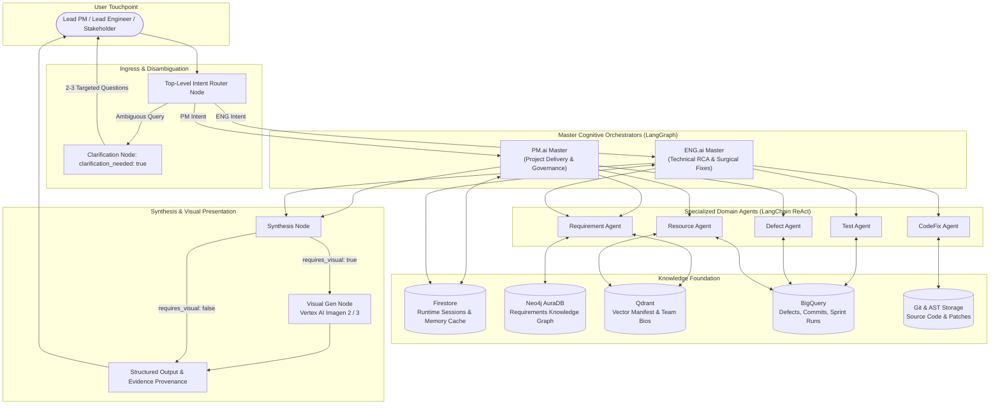
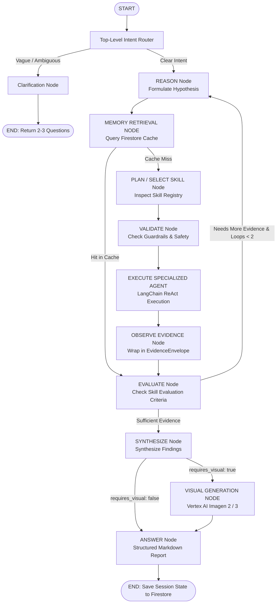

# ⬡ AXIOM: Evidence-Driven Multi-Agent Intelligence System

[](https://cloud.google.com/run)
[](https://cloud.google.com/vertex-ai)
[](https://github.com/langchain-ai/langgraph)
[](https://python.langchain.com/)
[](https://neo4j.com/cloud/platform/aura-graph-database/)
[](https://cloud.google.com/firestore)
[](https://www.python.org/)
[](https://fastapi.tiangolo.com/)

> **Detect. Decide. Deliver.**  
> An autonomous, evidence-driven multi-agent cognitive intelligence platform deployed on Google Cloud for safety-critical and high-velocity engineering programs.

---

## 📖 Table of Contents

- [Overview](#-overview)
- [System Architecture](#-system-architecture)
- [The Dual Cognitive Masters](#-the-dual-cognitive-masters)
- [Specialized LangChain ReAct Agents](#-specialized-langchain-react-agents)
- [Knowledge Foundation](#-knowledge-foundation)
- [Master Cognitive Workflow](#-master-cognitive-workflow)
- [The EvidenceEnvelope Standard](#-the-evidenceenvelope-standard)
- [Repository Structure](#-repository-structure)
- [Quickstart & Installation](#-quickstart--installation)
- [Running AXIOM](#-running-axiom)
  - [1. Interactive CLI](#1-interactive-cli)
  - [2. FastAPI REST Server & Web UI](#2-fastapi-rest-server--web-ui)
  - [3. Streamlit Visual Dashboard](#3-streamlit-visual-dashboard)
  - [4. Docker & Google Cloud Run Deployment](#4-docker--google-cloud-run-deployment)
- [Example Queries](#-example-queries)
- [Safety Guardrails & Non-Negotiables](#-safety-guardrails--non-negotiables)
- [License](#-license)

---

## 🌟 Overview

Modern automotive and mission-critical engineering programs struggle with complex traceability, disconnected issue trackers, opaque root causes, and schedule slippage. **AXIOM** bridges this gap using a **Cognitive Multi-Agent Architecture**:

- **Dual LangGraph Master Orchestrators**: **PM.ai** (Governance & Delivery) and **ENG.ai** (Technical RCA & Surgical Patches) reason over project objectives.
- **Top-Level Intent Router**: Classifies incoming queries, disambiguates vague user requests via proactive clarification questions, and routes to the appropriate Master.
- **Evidence-Driven Operation**: Masters never guess. They form hypotheses, query Firestore memory, delegate investigation tasks to specialized domain agents, and enforce strict evidence checklists.
- **Specialized ReAct Agents**: Autonomous agents equipped with tools to query Neo4j, BigQuery, Qdrant, and Git AST trees.
- **Visual-First Synthesis**: Generates visual diagrams and representations using Vertex AI Imagen (with Mermaid fallback) for high-impact communication.

---

## 🏛️ System Architecture



---

## 👑 The Dual Cognitive Masters

| Master | Role & Purpose | Key Capabilities | Prohibited Actions (Non-Negotiables) |
|---|---|---|---|
| **PM.ai** | Program Management, delivery governance, milestone protection, sprint replanning, defect business triage. | `defect_triage`<br>`sprint_replanning`<br>`resource_rebalancing`<br>`milestone_governance` | ❌ MUST NOT assert code root causes<br>❌ MUST NOT generate code patches<br>❌ MUST NOT close defects without QA verification |
| **ENG.ai** | Technical root-cause discovery, AST code analysis, surgical patch generation, test coverage expansion. | `root_cause_analysis`<br>`eight_d_analysis`<br>`surgical_patch_generation`<br>`test_coverage_expansion` | ❌ MUST NOT alter milestone commitments<br>❌ MUST NOT commit code without human PR review<br>❌ MUST NOT reassign engineers without PM.ai approval |

---

## 🤖 Specialized LangChain ReAct Agents

Masters do not query databases directly; they delegate to bounded **Specialized Agents** running ReAct loops:

1. **`requirement_agent` ([agents/requirement_agent.py](file:///c:/Users/bhavya/Jyothi/Axiom/agents/requirement_agent.py))**:
   - **Tools**:
     - `requirement_details_tool`: Retrieves full specification text, status, verification criteria, variants, and component allocations for single or multiple Requirement IDs (`REQ-...`).
     - `impact_analysis_tool`: Traverses Neo4j for upstream/downstream dependencies, blast radius, and semantic defect-to-requirement matching.
2. **`defect_agent` ([agents/defect_agent.py](file:///c:/Users/bhavya/Jyothi/Axiom/agents/defect_agent.py))**:
   - Triages issues, evaluates severity/urgency, and tracks defect blast radius in BigQuery.
3. **`test_agent` ([agents/test_agent.py](file:///c:/Users/bhavya/Jyothi/Axiom/agents/test_agent.py))**:
   - Queries BigQuery test execution records, analyzes regression risk, and auto-generates executable `pytest` suites.
4. **`resource_agent` ([agents/resource_agent.py](file:///c:/Users/bhavya/Jyothi/Axiom/agents/resource_agent.py))**:
   - Queries developer capacity, sprint velocity, and performs Qdrant semantic bio matching for developer task allocation.
5. **`codefix_agent` ([agents/codefix_agent.py](file:///c:/Users/bhavya/Jyothi/Axiom/agents/codefix_agent.py))**:
   - Performs Python AST inspection on source modules, generates surgical patches (`git diff`), and validates syntax integrity.

---

## 🧠 Knowledge Foundation

AXIOM combines four storage foundations to guarantee zero-hallucination execution:

1. **Neo4j AuraDB (Requirements Knowledge Graph)**:
   - **179 Nodes**: 74 Requirements, 5 Components, 4 Variants (`VAR-BASE`, `VAR-PREM`, `VAR-FLEET`, `VAR-GLOB`), 6 OEMs, 79 Test Cases.
   - **877 Edges**:
     - *718 Direct Edges*: `CHILD_OF`, `PARENT_OF`, `ALLOCATED_TO`, `TARGETS_VARIANT`, `CUSTOMIZED_FOR_OEM`, `VERIFIED_BY`, `IS_OF_TYPE`, `VERIFIED_AT_LEVEL`.
     - *159 Semantic Edges*: `VARIANT_DIVERGENCE_OF`, `CO_ALLOCATED_WITH`, `SEMANTIC_AFFINITY`.
   - *In-memory fallback (`_DYNAMIC_KG`) enables offline testing without an active Neo4j connection.*
2. **Google Cloud Firestore**:
   - Stores session conversation turns, user preferences, and verified EvidenceEnvelopes for fast-path retrieval.
3. **Qdrant Vector Database**:
   - Stores embeddings for project manifest, team member skills, and technical specifications.
4. **Google BigQuery**:
   - Warehouses project facts, sprint velocity history, historical defects, and test suite execution logs.

---

## 🔄 Master Cognitive Workflow

Every inquiry executes through a compiled **LangGraph StateGraph** (`orchestrator/graph.py`):



---

## 📦 The EvidenceEnvelope Standard

All findings passed between agents and Masters follow the strict **EvidenceEnvelope** contract:

```json
{
  "artifact_id": "GH-ISSUE-107",
  "artifact_type": "github_issue",
  "source_system": "github_tracker",
  "source_uri": "https://github.com/axiom-org/axiom-core/issues/107",
  "version": "1.0",
  "updated_at": "2026-10-04T12:00:00Z",
  "authoritative": true,
  "synthetic": false,
  "quality_status": "verified",
  "payload": {
    "title": "Proximity boundary oscillation causes rapid lock/unlock chatter at 2.0m",
    "severity": "S1_CRITICAL",
    "urgency": "U1_IMMEDIATE",
    "linked_requirement": "REQ-L2-001",
    "state": "OPEN"
  }
}
```

---

## 📂 Repository Structure

```
c:\Users\bhavya\Jyothi\Axiom\
├── app.py                           # FastAPI Web & REST Application Server
├── main.py                          # Unified CLI Entry Point (Interactive & One-shot)
├── streamlit_app.py                 # Pure-Python Streamlit Interactive Dashboard
├── Dockerfile                       # GCP Cloud Run Container Definition
├── cloudbuild.yaml                  # Google Cloud Build CI/CD Pipeline
├── requirements.txt                 # Core Dependencies (LangGraph, FastAPI, Neo4j, etc.)
│
├── orchestrator/                    # LangGraph Cognitive Core
│   ├── graph.py                     # Compiled Master LangGraph Application
│   ├── router.py                    # Top-Level Router & Disambiguation Node
│   ├── pm_master.py                 # PM.ai Cognitive State Graph
│   ├── eng_master.py                # ENG.ai Cognitive State Graph
│   ├── state.py                     # Pydantic & TypedDict LangGraph State Envelopes
│   └── visual_gen.py                # Vertex AI Imagen 2/3 Visual Generator
│
├── agents/                          # Specialized LangChain ReAct Agents
│   ├── requirement_agent.py         # Requirement Analysis Agent (Neo4j interface)
│   ├── defect_agent.py              # Defect Triage & Severity Specialist
│   ├── test_agent.py                # BigQuery QA & Test Automation Specialist
│   ├── resource_agent.py            # Developer Capacity & Velocity Specialist
│   ├── codefix_agent.py             # AST Root-Cause & Surgical Patch Specialist
│   ├── tools/                       # Specialized Agent Tool Implementations
│   │   ├── requirement_details_tool.py # Fetches single/multiple requirement details
│   │   ├── impact_analysis_tool.py     # Graph traversal & blast radius calculator
│   │   ├── neo4j_tools.py              # Neo4j Driver & _DYNAMIC_KG fallback
│   │   ├── bigquery_tools.py           # BigQuery Mock & Live Query Engine
│   │   ├── qdrant_tools.py             # Qdrant Vector Search Engine
│   │   ├── firestore_tools.py          # Firestore Runtime Evidence Memory
│   │   └── git_storage_tools.py        # Python AST parser & patch generator
│   └── utils/
│       └── neo4j_utils.py           # Cypher queries for details and impact
│
├── registries/                      # Master Registries
│   ├── capability_matrix.json       # Capabilities -> Skills -> Agents Mapping
│   ├── skill_registry.json          # Master Cognitive Skills Catalog
│   └── agent_registry.json          # Specialized Agent Registry & Cards
│
├── skills/                          # Declarative JSON Skill Definitions
│   ├── defect_correlation_skill.json
│   ├── velocity_analysis_skill.json
│   ├── root_cause_discovery_skill.json
│   ├── test_coverage_analysis_skill.json
│   └── eight_d_problem_solving_skill.json
│
├── agent_cards/                     # Bounded Agent Contracts & Schemas
│   ├── requirement_agent.json
│   ├── defect_agent.json
│   ├── test_agent.json
│   ├── resource_agent.json
│   └── codefix_agent.json
│
├── prompts/                         # Master & Agent System Prompts
│   ├── pm_master_prompt.md          # PM.ai Cognitive Instructions & Guardrails
│   ├── eng_master_prompt.md         # ENG.ai Cognitive Instructions & Guardrails
│   └── router_prompt.md             # Intent Router & Disambiguation Rules
│
└── data/                            # Raw Datasets & Knowledge Graph Scripts
    ├── requirements_master_v5.csv   # Requirements Source Data
    ├── test_cases_master_v5.csv     # Test Traceability Source Data
    └── neo4j_import_script.cypher   # Cypher Script with Vector Indexing
```

---

## ⚡ Quickstart & Installation

### 1. Prerequisites
- **Python**: 3.10+ (Recommended: 3.12)
- **Google Cloud Platform Project** (Optional, for Vertex AI & Firestore)
- **Neo4j AuraDB** free tier account (Optional, falls back to dynamic in-memory graph)

### 2. Clone and Setup Environment

```bash
# Clone the repository
git clone https://github.com/axiom-org/axiom.git
cd Axiom

# Create and activate virtual environment
python -m venv venv
# On Windows:
.\venv\Scripts\activate
# On Linux/macOS:
source venv/bin/activate

# Install dependencies
pip install -r requirements.txt
```

### 3. Configure Environment Variables

Copy `.env.example` to `.env` and fill in your connection details:

```bash
cp .env.example .env
```

```env
# Neo4j AuraDB (Optional: if blank, uses dynamic in-memory graph)
NEO4J_URI=neo4j+s://your-instance.databases.neo4j.io
NEO4J_USERNAME=neo4j
NEO4J_PASSWORD=your_password

# Google Cloud Platform
GOOGLE_CLOUD_PROJECT=your-gcp-project-id
GCP_LOCATION=us-central1
GEMINI_API_KEY=your_gemini_api_key

# Models
VERTEX_AI_GEMINI_MODEL=gemini-1.5-pro
VERTEX_AI_IMAGEN_MODEL=imagegeneration@006
```

---

## 🚀 Running AXIOM

AXIOM supports four execution interfaces:

### 1. Interactive CLI

Launch the interactive console with live cognitive trace and banner:

```bash
python main.py
```

Run a one-shot query directly:

```bash
python main.py "What is the blast radius and defect triage for GH-ISSUE-107?"
```

### 2. FastAPI REST Server & Web UI

Start the high-performance ASGI server:

```bash
uvicorn app:app --reload --host 0.0.0.0 --port 8080
```

- **API Documentation**: Open [http://localhost:8080/docs](http://localhost:8080/docs)
- **Health Check Probe**: Open [http://localhost:8080/api/health](http://localhost:8080/api/health)
- **Knowledge Graph Statistics**: Open [http://localhost:8080/api/kg/stats](http://localhost:8080/api/kg/stats)

### 3. Streamlit Visual Dashboard

Launch the dark-mode interactive dashboard:

```bash
streamlit run streamlit_app.py
```

Open [http://localhost:8501](http://localhost:8501) to explore live prompts, Knowledge Graph metrics, and visual artifacts.

### 4. Docker & Google Cloud Run Deployment

#### Run with Docker locally:
```bash
docker build -t axiom-orchestrator .
docker run -p 8080:8080 --env-file .env axiom-orchestrator
```

#### Deploy to Google Cloud Run via Cloud Build:
```bash
gcloud builds submit --config cloudbuild.yaml
```

---

## 💡 Example Queries

| Intent Category | Master | Example Query | Expected Behavior |
|---|---|---|---|
| **Defect Triage & Impact** | `PM.ai` | *"What is the blast radius and defect triage for GH-ISSUE-107?"* | Triages defect severity, queries Neo4j for linked requirements, and projects sprint impact. |
| **Code Root Cause Analysis** | `ENG.ai` | *"Perform deep code RCA and generate surgical patch for proximity_controller.py"* | Inspects AST trees, discovers threshold debounce bug, and outputs `git diff` patch. |
| **Requirement Details (Single)** | `requirement_agent` | *"Get requirement details for REQ-L2-001"* | Invokes `requirement_details_tool` and returns text, status, level, component, and tests. |
| **Requirement Details (Multi)** | `requirement_agent` | *"Show details for REQ-L2-001 and REQ-L3-001"* | Returns specifications, verification criteria, and component mappings for all requested IDs. |
| **Sprint Replanning** | `PM.ai` | *"Sprint 4 is slipping by 18 story points, how should we replan?"* | Analyzes velocity, identifies lower-priority items, and creates a rebalanced scope proposal. |
| **Ambiguity Disambiguation** | `Router` | *"Fix something"* or *"hi"* | Returns `clarification_needed: true` with 2-3 specific questions instead of looping. |

---

## 🛡️ Safety Guardrails & Non-Negotiables

To guarantee predictable, production-grade autonomy, AXIOM implements strict safety guardrails:

1. **Strict Evidence Grounding**: Masters cannot synthesize answers without at least one verified `EvidenceEnvelope`.
2. **Read-Only Database Boundaries**: Agents have query-only access to Neo4j and BigQuery; destructive mutations are forbidden.
3. **Deterministic Patch Validation**: Patches proposed by `codefix_agent` must parse cleanly via Python `ast.parse()` before being presented.
4. **Human-in-the-Loop Decision Rights**: AXIOM never automatically merges code pull requests or modifies signed-off project milestone dates.

---

## 📄 License

This project is licensed under the Apache 2.0 License - see the LICENSE file for details.
