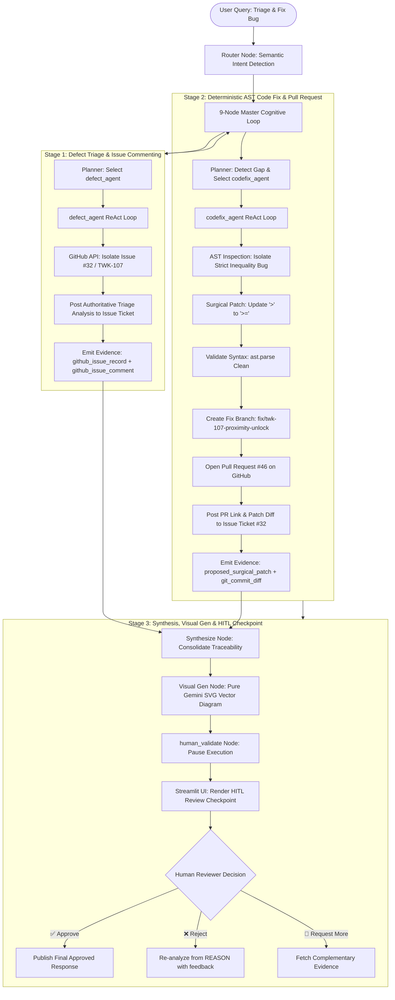

# 🔄 AXIOM End-to-End Defect Triage, Surgical Code Fix & HITL Pipeline

**Document Version:** 2.0.0  
**Target Systems:** AXIOM Multi-Agent Intelligence System (`AXIOM-PM` & `AXIOM-ENG`)  
**Core Safety Constraint:** **Rule #3 Enforcement** — Automated Branch & Pull Request submission for human engineering review; zero direct commits or autonomous merges to `main`.

---

## 📌 Executive Summary

This document specifies the operational logic, multi-agent coordination, and architectural data flow for AXIOM's automated **3-Stage Defect Remediation Lifecycle**:



---

## 1. Stage 1: Defect Triage & Authoritative Issue Ticket Commenting

### 1.1 Objective
Query live GitHub issue trackers (`JyothiLakshmikanth/EKey2W/issues`) or BigQuery sprint planning datasets, calculate deterministic severity/urgency scores, identify probable defect leakage vectors, and **post the technical triage analysis directly into the GitHub issue ticket**.

### 1.2 Issue Matching & Pull Request Discrimination
In GitHub's REST API (`/repos/{owner}/{repo}/issues`), Pull Requests are returned alongside standard issues. To prevent matching a fix PR instead of the root defect ticket, `github_find_matching_issue` applies issue discrimination:
```python
# agents/tools/github_tools.py
actual_issues = [i for i in issues if "pull_request" not in i]
search_pool = actual_issues if actual_issues else issues
```
- **Target Defect:** GitHub Issue #32 (`[TWK-107] Boundary-Zone Unlock Intermittently Fails`)
- **Governing Requirement:** `REQ-L5-003` (Base BLE RSSI Threshold -65 dBm)
- **Verification Test Case:** `TC-UNL-006` / `TC-005`

### 1.3 Issue Ticket Commenting Logic
`defect_agent` calculates the severity/urgency classification and immediately posts the assessment to the GitHub issue ticket:
```markdown
### 📋 AXIOM Defect Triage & Impact Assessment

**Defect Triage Assessment:**
- **Issue:** #32 - [TWK-107] Boundary-Zone Unlock Intermittently Fails
- **Severity Score:** `S1_CRITICAL`
- **Urgency Score:** `U1_IMMEDIATE`
- **Leakage Direction:** Proximity Controller Logic (Boundary Condition / Threshold Operator Missing)
- **Impacted Milestone:** Sprint 3

**Traceability & Verification Matrix:**
- **Governing Requirement:** `REQ-L5-003` (Base BLE RSSI Threshold -65 dBm)
- **Verification Test Suite:** `TC-UNL-006`

**Analysis Summary & Next Steps:**
- Signal evaluation logic in `src/ekey2w/vehicle/proximity_controller.py` demonstrates boundary instability at `-65 dBm`.
- Proceeding to AST Root Cause Isolation and Surgical Code Fix via AXIOM CodeFix Specialist Agent.
```
- **Evidence Produced:** `github_issue_record` and `github_issue_comment`.

---

## 2. Stage 2: Deterministic AST Code Fix, Branching & Pull Request

### 2.1 Objective
Inspect the source code AST, confirm the exact boundary logic flaw, synthesize a verifiable minimal patch, create a dedicated fix branch, and open an authoritative Pull Request on GitHub.

### 2.2 AST Root Cause Isolation
`codefix_agent` walks the Abstract Syntax Tree of `src/ekey2w/vehicle/proximity_controller.py` to inspect the `should_unlock_ble` function:
```python
# Flawed implementation at line 14:
return bool(authorized_key) and rssi_dbm > threshold_dbm
```
- **The Defect:** Using strict inequality (`>`) rejects an authorized key when the received BLE RSSI signal is exactly at the configured boundary threshold (`-65 dBm`).
- **Surgical Mutation:**
```python
# FIXED (TWK-107 / REQ-L5-003): Accept BLE signals at or above the threshold
return bool(authorized_key) and rssi_dbm >= threshold_dbm
```

### 2.3 Deterministic Patch Validation
Before committing or creating a PR, the candidate code is compiled via Python's built-in `ast.parse()`:
```python
ast.parse(fixed_code) # Confirms 0 syntax or compilation errors
```

### 2.4 GitHub Branch & PR Creation (Rule #3 Compliance)
1. **Branch Creation:** Creates/reuses `fix/twk-107-proximity-unlock` from `main`.
2. **Commit:** Pushes surgical fix with commit message:
   `fix(proximity): accept BLE signals at exact threshold (TWK-107 / REQ-L5-003)`
3. **Pull Request:** Submits **[PR #46 on JyothiLakshmikanth/EKey2W](https://github.com/JyothiLakshmikanth/EKey2W/pull/46)**.
4. **Issue Notification:** Posts PR confirmation comment back to Issue #32 with links to branch and PR.

---

## 3. Stage 3: Synthesis, Vector Diagram & Human-in-the-Loop (HITL) Checkpoint

### 3.1 Synthesis & Visual Generation
- **LLM Synthesis:** Synthesizes the multi-agent journey across `defect_agent` and `codefix_agent`.
- **Pure LLM SVG Vector Visual:** The **same Gemini LLM** (`gemini-flash-lite-latest` / `gemini-1.5-flash-001`) dynamically generates a complete SVG flowchart (dark mode, crisp typography, colored status nodes) and returns it as a base64 Data URI (`data:image/svg+xml;base64,...`) for instant rendering in `st.image()`.
- **Mermaid.js CDN Fallback:** If SVG fallback is used, rendered via `streamlit.components.v1.html` with client-side Mermaid rendering.

### 3.2 Human-in-the-Loop Checkpoint (`streamlit_components/hitl_renderer.py`)
Execution halts at `human_validate_node` (`state["human_validation_required"] = True`). Streamlit stores the state in `st.session_state.pending_hitl_state` and renders:
1. **📊 Executive Findings & Analysis Sections**
2. **🎨 Generated Visual Vector Diagram** (SVG / Mermaid)
3. **🔀 Pull Request Badge:** Direct link to [PR #46](https://github.com/JyothiLakshmikanth/EKey2W/pull/46) and branch `fix/twk-107-proximity-unlock`.
4. **📝 Unified Patch Diff:** Expandable interactive diff viewer.
5. **💬 GitHub Issue Comment Links:** Clickable links to comments on Issue #32.
6. **Interactive Review Buttons:**
   - `✅ Approve Fix & PR`: Marks validation as `APPROVED` and delivers the final response.
   - `❌ Reject Proposed Fix`: Prompts for feedback and returns to `REASON` for re-analysis.
   - `📝 Request Additional Analysis`: Prompts for specific areas and loops back to `PLAN`.

---

## 4. Master Cognitive Configuration Matrix

| Capability ID | Target Master | Required Evidence Dimensions | Execution Sequence |
|---|---|---|---|
| `defect_triage_and_remediation` | `AXIOM-ENG` | `github_issue_record`, `defect_leakage_assessment`, `source_ast_inspection`, `proposed_surgical_patch` | Iter 1: `defect_agent` (Triage & Issue Comment) <br> Iter 2: `codefix_agent` (AST Fix & PR) |
| `code_fixing` | `AXIOM-ENG` | `github_issue_record`, `source_ast_inspection`, `proposed_surgical_patch` | Iter 1: `defect_agent` <br> Iter 2: `codefix_agent` |
| `defect_triage` | `AXIOM-PM` | `github_issue_record`, `defect_leakage_assessment`, `severity_urgency_matrix`, `requirement_record` | Iter 1: `defect_agent` <br> Iter 2: `requirement_agent` |

---

## 5. Live Production Verification Reference

- **Target Repository:** `JyothiLakshmikanth/EKey2W`
- **Defect Ticket:** [Issue #32](https://github.com/JyothiLakshmikanth/EKey2W/issues/32)
- **Triage Comment:** [Issue #32 Comment 6251459041](https://github.com/JyothiLakshmikanth/EKey2W/issues/32#issuecomment-6251459041)
- **Pull Request Created:** [PR #46](https://github.com/JyothiLakshmikanth/EKey2W/pull/46)
- **Fix Branch:** [`fix/twk-107-proximity-unlock`](https://github.com/JyothiLakshmikanth/EKey2W/tree/fix/twk-107-proximity-unlock)
- **Target File:** `src/ekey2w/vehicle/proximity_controller.py`
